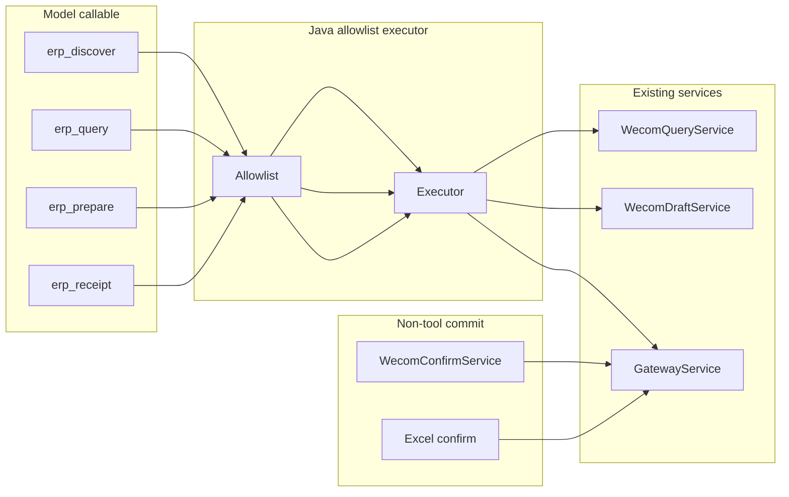

# ADR · AIERP-019A 通用能力网关（erp_discover / query / prepare / receipt）

**状态**：Proposed（docs-only，019B 编码）  
**日期**：2026-10-21  
**分支**：`product/aierp-019a-capability-catalog-skills`  
**前置**：012A 身份、013 只读、015A 采购 DRAFT、003 会话网关、014D 确认协议、015B（master，未合并入本分支）

## 1. 问题

12 个 OpenClaw 专用 Tool 可维护但难扩展；需要**单一受控入口**，让 Agent 通过 operationId 组合能力，同时禁止任意 HTTP/SQL 与模型侧过账。

## 2. 决策

### 2.1 四个模型可见通用 Tool（019B MVP 起）

| Tool | 作用 | 允许 sideEffectLevel | 拒绝 |
|---|---|---|---|
| `erp_discover` | 按意图/关键词返回**当前用户 allowlist** 内的 operationId、必填参数、sideEffect | READ（元数据） | 未注册 id、内部 URL、表名 |
| `erp_query` | 执行只读 operationId | READ | DRAFT/COMMIT/HIGH_RISK |
| `erp_prepare` | 执行草稿 operationId | DRAFT | COMMIT、confirm |
| `erp_receipt` | 读已过账回执/批次结果/PDF 状态 | READ | 任意路径读文件 |

**永不注册**：`erp_confirm`、`erp_draft_confirm`、`excel.confirm` 包装、原始 `draft.confirm` 会话 API。

### 2.2 候选 HTTP 面（Java 单入口，非 LLM 自选 path）

```
POST /aierp/v1/agent/discover   { intent?, keyword?, locale? }
POST /aierp/v1/agent/query      { operationId, params }
POST /aierp/v1/agent/prepare    { operationId, params }
POST /aierp/v1/agent/receipt    { operationId, params }
```

- 请求体**仅**允许 `operationId` + `params` JSON；**禁止** `url`、`method`、`sql`、`rawBody`。
- 企微链：OpenClaw HMAC 适配器注入 `wecomUserId`；Java `resolveBoundActiveUser`。
- 会话链（Demo）：`X-Access-Token`；Discover 返回的 id 集可不同。

### 2.3 静态 allowlist

- 源文件：`deploy/openclaw/catalog/erp-capabilities.yaml`（文档）→ 019B 编译/启动加载为 **immutable Set**。
- 每条：`operationId` → 处理器 bean 方法 + schema 校验 + sideEffectLevel + auth 模式。
- 越权调用返回 403 `OPERATION_NOT_ALLOWED`；写级 operationId 误传入 `erp_query` 返回 400。

### 2.4 Java 执行图（019B）

```text
OpenClaw erp_query/prepare/receipt
    → signedPost /agent/* (HMAC)
        → AierpAgentController (new)
            → AierpAgentAllowlist#resolve(operationId)
            → AierpAgentExecutor
                ├─ READ/wecom  → AierpWecomQueryService / AierpWecomBindingService#stockQueryDelegated
                ├─ DRAFT/wecom → AierpWecomDraftService (purchase.prepare …)
                ├─ DRAFT/session → AierpGatewayService#createDraftAs (future delegate)
                └─ receipt     → AierpWecomReceiptService / AierpExcelService#receipt (read-only)
```

**不经过** Agent 层的操作（保持独立）：

- `draft.confirm.wecom`：OpenClaw `before_dispatch` → HMAC `POST /aierp/v1/wecom/draft/confirm`（015B，`AierpWecomConfirmService#confirmFromTrustedInbound`）。
- `draft.confirm-ui`：ERP Session → `confirmUi`。
- `excel.confirm`：`AierpExcelController#confirm`（UI 按钮）。
- `binding.claim`：ERP Session。



### 2.5 IO 契约（摘要）

**erp_discover**

```json
// in
{ "intent": "查原料仓库存", "keyword": "stock" }
// out
{
  "operations": [
    {
      "operationId": "stock.query",
      "titleZh": "实时库存查询",
      "sideEffectLevel": "READ",
      "requiredParams": ["query"],
      "modelCallable": true
    }
  ],
  "nature": "CAPABILITY_CATALOG"
}
```

**erp_query**

```json
// in
{ "operationId": "stock.query", "params": { "query": "RM-A001", "depotName": "原料仓" } }
// out — 与现 WeCom 路由 data 一致，附 nature=REAL_ERP
```

**erp_prepare**

```json
// in
{ "operationId": "purchase.prepare", "params": { "barCode": "RM-A001", "qty": 10, "unit": "L", "depotName": "原料仓", "organName": "华东化工", "idempotencyKey": "wx-20261021-1" } }
// out — 同 erp_purchase_prepare details
```

**erp_receipt**

```json
// in
{ "operationId": "excel.receipt", "params": { "batchId": "batch-uuid" } }
// out — 元数据 + downloadToken 或 inline summary；PDF 仅 015B receipt.pdf 且非 model 直传 bytes
```

### 2.6 015B 确认路径隔离

- 确认**不**进入 `erp_prepare` / `erp_query`。
- 挑战签发（015B）由 Java 在 DRAFT_READY 后生成；消费仅 `confirmFromTrustedInbound` 或 `confirmUi`。
- `AierpGatewayService#confirmAs(VerifiedActor, …)` 为唯一过账内核；015B 与 `confirmInTx`（会话）共享事务/锁/幂等规则。

### 2.7 安全不变量

- 无任意 HTTP 客户端 Tool；无 SQL；无文件系统 Tool 给 LLM。
- Adapter Secret、ERP Token、bindCode 不出现在 Tool schema。
- 群聊拒绝写路径与 confirm。
- Tenant/仓库/功能号在 executor 内重验，不信任模型传的 tenantId/depotId（除非为只读结果中的显式选择且二次校验）。

## 3. 019A 分支差异说明

本 worktree `AierpWecomController` **无** confirm/receipt 路由；catalog 中 015B 条目标记 `PLANNED_015B_ON_MASTER`。019A PR 仅交付目录 + Skills + 本 ADR。

## 4. 后果

- 019B 可先上 `erp_discover`+`erp_query` 对标 13 五查询，保留 12 Tool 兼容。
- 每新增 operationId 需 YAML + allowlist + 集成测试，避免文档漂移。
- mix/service 企微 prepare 在 016/019B 前 Discover 不得返回可 prepare 的 mix/service id（或返回 `planned: true` 且 executor 拒绝）。
